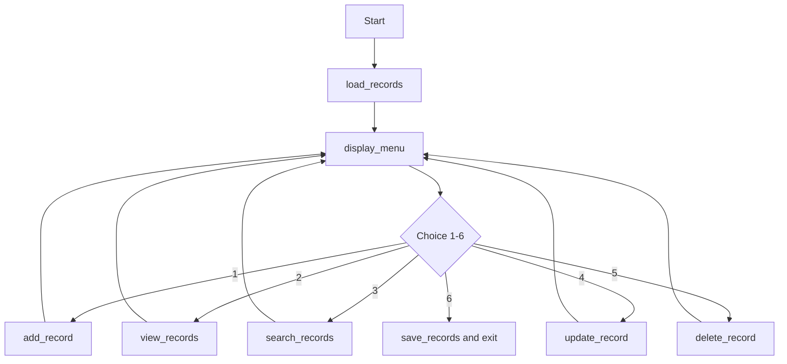

# Mini Project Report: Console Record-Management Application

**Project:** Student Record Management System
**Language:** Python 3
**Author:** `<your-name>`
**Repository:** `https://github.com/<your-username>/<your-repository-name>`

---

## 1. Aim

To build a menu-driven console application that manages records (add, view, search, update, delete) and keeps them in a file, using functions, validation and exception handling.

## 2. Objectives

1. Use suitable data types and data structures to represent records.
2. Use conditionals and loops to control program flow and validate input.
3. Break the program into small, reusable functions.
4. Handle invalid input and file errors without crashing.
5. Store records in a file so they persist between runs.
6. Provide a clear, repeating menu interface.

## 3. Tools and Environment

- Python 3.8 or later, standard library only (`json`)
- Any terminal or IDE; tested from the command line
- Data stored in `records.json`

## 4. Design

### 4.1 Data structure

Records live in one dictionary. The key is the student ID and the value is a dictionary of that student's fields. A dictionary gives constant-time lookup by ID, which keeps search, update and delete simple.

```python
records = {
    "S001": {"name": "Asha Rao", "age": 20, "course": "Python", "marks": 88.5},
    "S002": {"name": "Vikram Singh", "age": 23, "course": "Data Science", "marks": 76.5},
}
```

### 4.2 File format

The dictionary is saved as JSON (`records.json`), which is human-readable and maps directly onto Python dictionaries.

### 4.3 Program flow



### 4.4 Functions

| Function | Purpose |
|---|---|
| `load_records()` | Reads `records.json`; returns an empty dictionary if the file is missing or corrupted |
| `save_records()` | Writes all records to `records.json`; returns `True` or `False` |
| `get_text()` | Prompts until non-empty text is entered (or allows blank when updating) |
| `get_int()` | Prompts until a whole number inside a range is entered |
| `get_float()` | Prompts until a number inside a range is entered |
| `generate_id()` | Creates the next ID (S001, S002, ...) from the highest existing number |
| `calculate_grade()` | Converts marks to a letter grade |
| `print_table()` | Prints rows as an aligned table |
| `add_record()` | Collects validated input and adds a record |
| `view_records()` | Shows all records, sorted by ID |
| `search_records()` | Finds records by ID, name or course |
| `update_record()` | Changes selected fields of a record |
| `delete_record()` | Deletes a record after confirmation |
| `display_menu()` | Prints the menu |
| `main()` | Loads data and runs the menu loop |

## 5. Mapping to Required Concepts

**Data types and variables.** `str` for names and courses, `int` for age, `float` for marks, `bool` (`running`) to control the main loop, `dict` for records and the menu dispatch table, `list` for search matches, and constants (`DATA_FILE`, `MIN_AGE`, `MAX_AGE`, `MIN_MARKS`, `MAX_MARKS`) for fixed settings.

**Conditionals and loops.** `calculate_grade()` uses an `if/elif/else` chain. The input helpers use `while True` loops that repeat until the input is valid. `main()` uses `while running` for the menu. `search_records()` and `print_table()` use `for` loops.

**Functions.** Every task is its own function with a docstring. Input helpers are reused by all the record operations, which avoids repeated code.

**Exception handling.**

| Exception | Where | Handling |
|---|---|---|
| `ValueError` | `get_int`, `get_float` | Message shown, user asked again |
| `FileNotFoundError` | `load_records` | Starts with an empty database (first run) |
| `json.JSONDecodeError` | `load_records` | Warning shown, starts with empty records |
| `OSError` | `load_records`, `save_records` | Error message; program keeps running |
| `KeyboardInterrupt`, `EOFError` | `main` | Saves data and exits cleanly |
| `Exception` | `main` | Last-resort message so one bug does not end the session |

**File I/O.** `load_records()` and `save_records()` use `with open(...)` so files are always closed, and `json.load` / `json.dump` to read and write. Data is saved after every add, update and delete, and again on exit.

**Menu-driven design.** `display_menu()` prints the options and `main()` dispatches the choice through a dictionary (`actions`) that maps menu numbers to functions.

## 6. Implementation Notes

- **ID generation:** the new ID is the highest existing number plus one, so IDs are never reused after a delete.
- **Search:** a term matches if it equals an ID exactly, or appears inside a name or course (lower-cased on both sides).
- **Update:** each prompt shows the current value in brackets; a blank answer keeps it. The numeric helpers return `None` for a blank answer so a real value of `0` is not confused with "no change".
- **Delete:** the record is shown first and removed only if the user types `y`.
- **Safe defaults:** a missing or corrupted data file never stops the program.

## 7. Testing

All tests were run by executing the program. Full transcripts are in `sample_session.txt` and the screenshots folder.

| # | Test | Input | Expected | Result |
|---|---|---|---|---|
| 1 | Add valid record | Asha Rao, 20, Python, 88.5 | Record saved as S001 | Pass |
| 2 | Add several records | Two more records | IDs S002, S003 | Pass |
| 3 | View all | Menu 2 | Table with 3 rows and grades | Pass |
| 4 | Search by name | `asha` | Shows S001 | Pass |
| 5 | Search by course | `data` | Shows S002 | Pass |
| 6 | Search with no match | `zzz` | "No records match" message | Pass |
| 7 | Update with blanks | S002, keep name, age 23, keep course, marks 76.5 | Only age and marks change | Pass |
| 8 | Empty name | blank | "Input cannot be empty", re-prompt | Pass |
| 9 | Non-numeric age | `abc` | "Please enter a whole number", re-prompt | Pass |
| 10 | Age out of range | `150` | "Value must be between 5 and 100", re-prompt | Pass |
| 11 | Marks out of range | `-5`, `101` | Range message, re-prompt | Pass |
| 12 | Invalid menu choice | `7`, `abc` | Error message, menu prompt repeats | Pass |
| 13 | Update unknown ID | `S999` | "No record found" | Pass |
| 14 | Delete unknown ID | `S999` | "No record found" | Pass |
| 15 | Delete, answer `n` | S004, `n` | "Deletion cancelled", record kept | Pass |
| 16 | Delete, answer `y` | S004, `y` | Record removed | Pass |
| 17 | Persistence | Exit and restart | Records reloaded from file | Pass |
| 18 | Missing data file | No `records.json` | Starts with 0 records, no crash | Pass |
| 19 | Corrupted data file | `{not json` in file | Warning, starts with empty records | Pass |
| 20 | Ctrl+D / end of input | Input stream closed | Saves and exits cleanly | Pass |

## 8. Challenges and Solutions

| Challenge | Solution |
|---|---|
| Repeating validation code in every operation | Shared helper functions `get_text`, `get_int`, `get_float` |
| Telling "blank" apart from `0` when updating | Helpers return `None` for blank; the code checks `is not None` |
| Reusing IDs after deletion | New ID is based on the maximum existing ID |
| A bad data file stopping the program at start | `load_records` catches file and JSON errors and starts fresh |

## 9. Limitations and Future Improvements

- Data is stored in a single JSON file and fully rewritten on each save; a database such as SQLite would suit larger data.
- Search does not support combining several fields.
- Possible additions: sorting options, exporting to CSV, a backup of the data file, and unit tests with `unittest`.

## 10. Conclusion

The application meets the requirements: it offers a repeating menu, supports add, view, search, update and delete, is organised into functions, validates input, handles file and runtime errors, and keeps data between runs through a JSON file.
